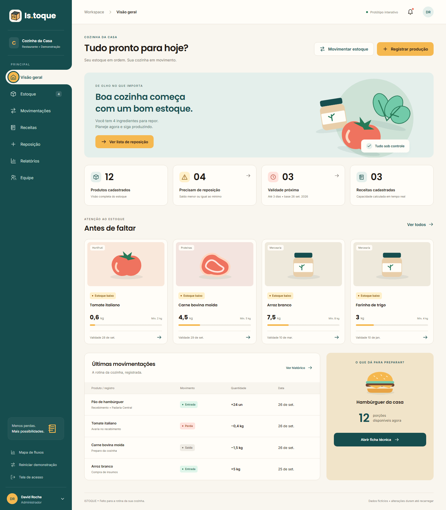
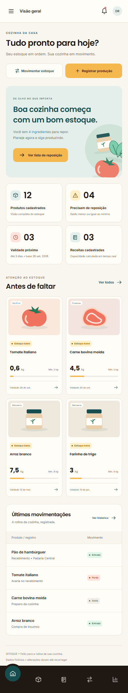

# Template padrão da Aplicação

Layout padrão do site (HTML e CSS) que será utilizado em todas as páginas com a definição de identidade visual, aspectos de responsividade e iconografia.

O front-end é uma aplicação React com Vite e CSS próprio, sem biblioteca de componentes visuais. Os estilos ficam em `codigo-fonte/Frontend/istoque/src/styles/` (`base/`, `layout/`, `components/`, `features/` e `utilities.css`), reunidos em `styles/index.css`.

## Identidade visual

### Paleta

As cores são variáveis CSS declaradas em `styles/base/tokens.css`.

| Uso | Variável | Valor |
| --- | --- | --- |
| Verde-petróleo, cor principal (menu lateral, botões, títulos) | `--teal` | `#164D4E` |
| Verde-petróleo ao passar o mouse | `--teal-hover` | `#0D3D3E` |
| Âmbar, destaque e botões de ação principal | `--amber` | `#F5B84F` |
| Fundo da aplicação | `--paper` | `#F9F6EF` |
| Fundo de cartões e painéis | `--panel` | `#FFFDF8` |
| Texto | `--ink` | `#1F1813` |
| Texto secundário | `--muted` | `#746D67` |
| Bordas | `--line` | `#E8E1D6` |
| Alerta, erro e sucesso | `--warning`, `--danger`, `--success` | `#875800`, `#B64232`, `#277957` |
| Contorno de foco do teclado | `--focus` | `#007D9D` |

Cada cor de estado tem também uma versão suave para fundos (`--warning-soft`, `--danger-soft`, `--success-soft`, `--soft`).

### Tipografia

- **Inter** (400 e 600) no texto da interface.
- **Poppins** (600 e 700) nos títulos (`h1` a `h3`).

As fontes são distribuídas com o projeto, em `public/fonts/`, com as licenças OFL, e carregadas por `styles/base/fonts.css`. Não há dependência de serviço externo de fontes. Os tamanhos seguem uma escala de variáveis (`--font-7` a `--font-37`).

### Forma e movimento

- Cartões e painéis com raio de 16 px (`--radius`); campos da tela de acesso com raio de 10 px.
- Animações curtas (100, 150 e 200 ms, com curvas padronizadas em `tokens.css`), feitas só com `transform`, `opacity` e propriedades individuais de transformação. Com a preferência "reduzir movimento" do sistema, as animações e transições são desligadas.

### Mascote e iconografia

- O mascote é uma caixa de papelão com rosto, desenhada em SVG inline (`components/ui/mascot.jsx`), com as variantes de uma e de duas caixas. Aparece no logo do menu, na tela de acesso, na tela de carregamento, nos estados vazios e na página inicial, e o olhar acompanha o preenchimento do formulário de acesso.
- Os ícones são SVG inline (`components/ui/icon.jsx`) e as ilustrações dos produtos e das receitas também são SVG.

## Estrutura da página

A tela de acesso (login e cadastro) e a página inicial têm composição própria. Todas as demais telas usam o layout padrão (`components/layouts/`):

- **Menu lateral** (`sidebar.jsx`): fixo à esquerda, em verde-petróleo, com o logo, a empresa, os itens Visão geral, Estoque, Movimentações, Receitas, Reposição, Relatórios e Equipe, o contador de estoque baixo e o usuário com o botão "Sair". Largura de 232 px, 205 px até 1200 px de tela e 190 px até 950 px. A aba ativa é um único elemento que desliza até o item selecionado.
- **Barra do topo** (`topbar.jsx`): caminho da tela, aviso "Protótipo interativo" na demonstração, sino de alertas e avatar do usuário.
- **Conteúdo**: título da tela, ações principais à direita, cartões e tabelas sobre o fundo `--paper`.
- **Rodapé**: texto fixo com a identificação do sistema.
- **Janelas de operação** (`components/ui/modal.jsx`): elemento `<dialog>` nativo, com título, fechamento por botão, Esc ou clique fora.

## Responsividade

Os pontos de quebra usados nos `@media` são 1650 px, 1200 px, 950 px e 700 px (celular).

- **Até 1200 px e 950 px:** o menu lateral estreita (205 px e 190 px) e o restante do layout se ajusta à largura disponível.
- **Até 700 px (celular):** o menu lateral vira uma gaveta, aberta pelo botão de menu da barra do topo; uma **barra inferior** fixa, em tom escuro, com ícones, dá acesso a Visão geral, Estoque, Receitas, Movimentações e Relatórios, com uma bolha verde que desliza até a tela ativa. Tabelas largas ganham rolagem interna.
- A tela de acesso reorganiza o cartão em uma coluna, com ponto de quebra próprio em 760 px.

## Componentes de formulário e botões

- Campos nativos (`input`, `select` e `textarea`) com altura mínima de 44 px, e botões com altura mínima de 44 px, para facilitar o toque.
- Campos de login e cadastro (componente `AuthField`): rótulo que sobe ao receber foco, altura de 54 px, raio de 10 px e botão de mostrar ou ocultar senha.
- Erros ligados ao campo por `aria-describedby`, exibidos abaixo dele, e foco no primeiro campo inválido ao enviar.
- Foco do teclado sempre visível, com a cor `--focus`.

Os detalhes da tela de acesso estão em [ux/cadastro-basico.md](ux/cadastro-basico.md), e as capturas de todas as telas em [ux/telas/README.md](ux/telas/README.md).
