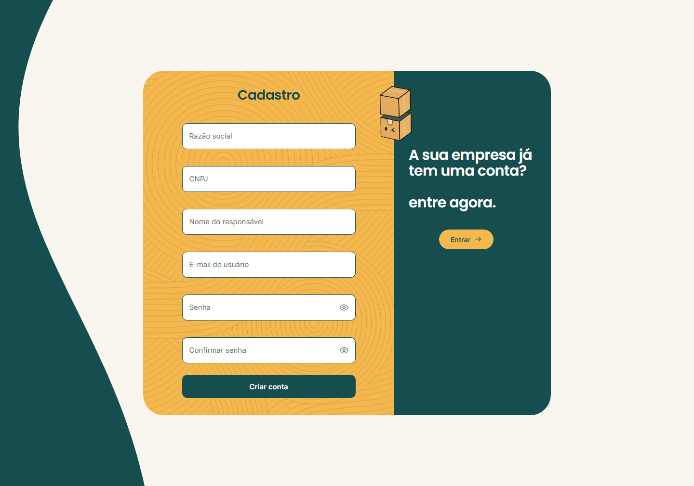
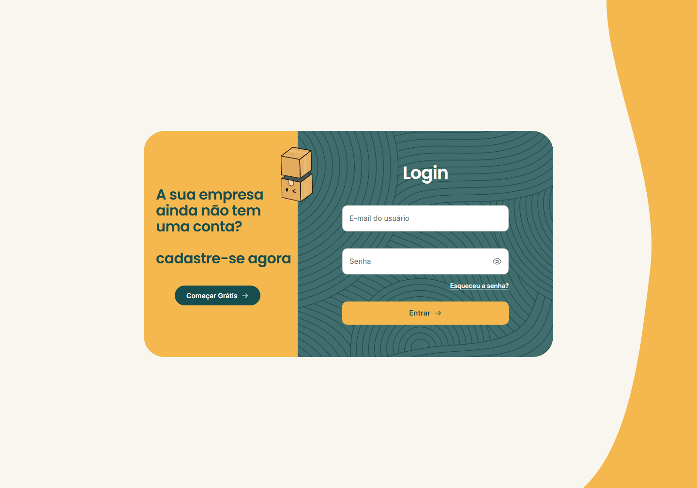
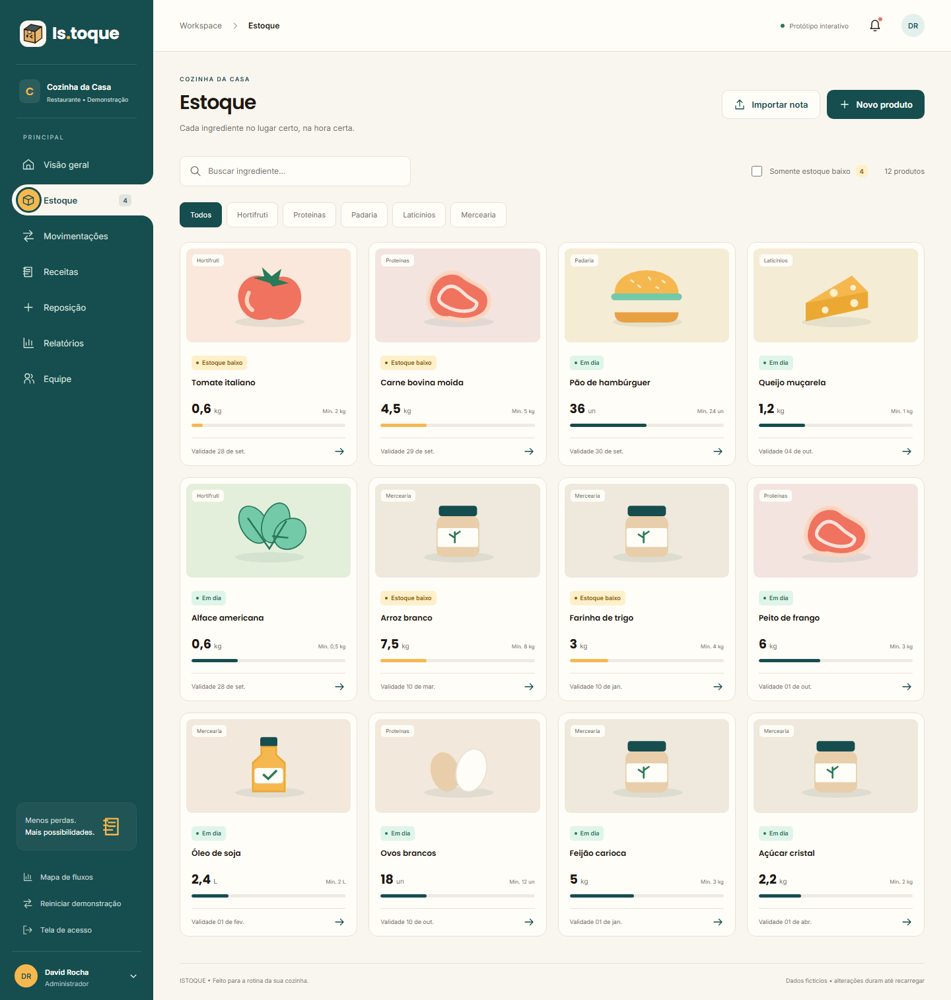
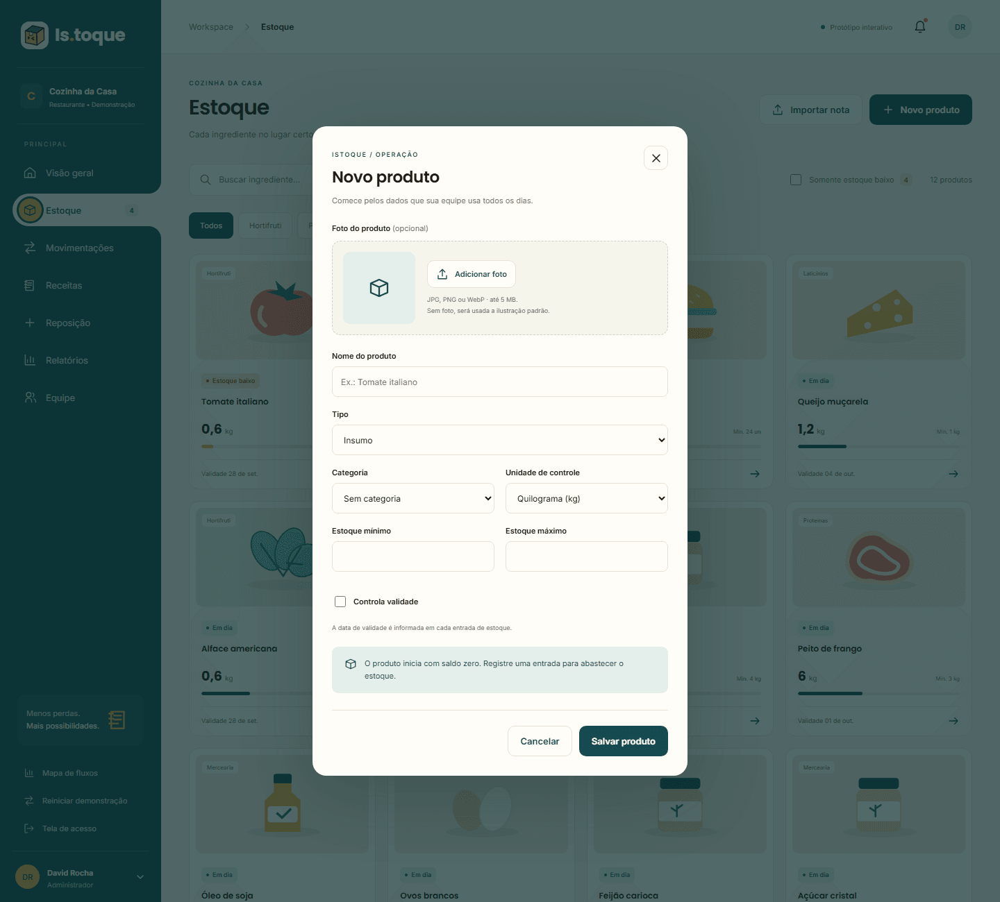
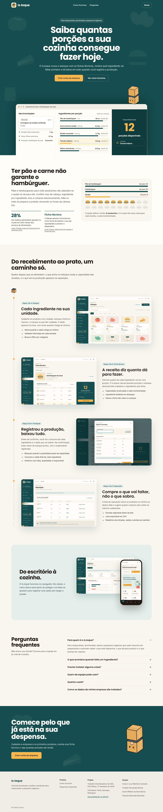

# Programação de Funcionalidades

Implementação da aplicação descritas por meio dos requisitos codificados. 

As funcionalidades abaixo estão entregues e integradas à API. Os caminhos dos arquivos partem de `codigo-fonte/Backend/istoque/src/main/java/br/com/istoque/` (backend) e `codigo-fonte/Frontend/istoque/src/` (frontend). As imagens são capturas do sistema em modo demonstração, listadas em [ux/telas/README.md](ux/telas/README.md). A API publicada está em [https://is-toque-prod.onrender.com](https://is-toque-prod.onrender.com) e o front-end em [https://istoque-front.onrender.com](https://istoque-front.onrender.com); a documentação dos endpoints está no [README do backend](../codigo-fonte/Backend/istoque/README.md).

### Cadastro de empresa e administrador

#### Requisito atendido

RF-01: O sistema deverá permitir o cadastro de empresas.

RF-02: O sistema deverá criar o usuário administrador junto com o cadastro da empresa. (HU001)

#### Artefatos da funcionalidade

- Backend: `controller/AuthController.java` (`POST /api/auth/cadastro`), `services/CadastroService.java`, `services/EmpresaService.java`, `services/PerfilService.java`, `services/UsuarioService.java`, `dto/CadastroRequestDTO.java`, `dto/CadastroResponseDTO.java`, `controller/EmpresaController.java` (CRUD de empresas), `util/CnpjUtils.java`, `util/EmailUtils.java`.
- Frontend: `features/auth/api/auth.js`, `features/auth/components/access-form.jsx`, `features/auth/components/auth-screen.jsx`, `features/auth/components/auth-controls.jsx`, `features/auth/components/auth.css`, `features/auth/utils/validation.js`.
- Testes: `CadastroIntegrationTest`, `EmpresaControllerIntegrationTest`, `CnpjUtilsTest`.

#### Estrutura de Dados

Requisição (`CadastroRequestDTO`): `razaoSocial` (obrigatória, até 150 caracteres), `cnpj` (14 caracteres alfanuméricos, com ou sem máscara), `nome` (até 120), `email` (válido, até 150) e `senha` (mínimo de 8 caracteres). Resposta `201` (`CadastroResponseDTO`): `{ empresa, usuario, token, expiraEm }`; o usuário já sai do cadastro logado. Em uma única transação, o sistema grava a empresa (tabela `empresa`), cria os perfis padrão Administrador, Gerente e Funcionário (tabela `perfil`) e grava o usuário administrador (tabela `usuario`, com a senha em BCrypt). CNPJ ou e-mail repetidos retornam `409` e nada é gravado.

#### Instruções de acesso

Em `#cadastro` (botão "Criar conta da empresa" na página inicial), preencha razão social, CNPJ, nome do responsável, e-mail, senha e confirmação da senha. Depois do cadastro, o sistema abre a visão geral já com a empresa criada.

#### Responsável

Eduardo Rezende (cadastro, empresas e tela). Primeira versão da API de usuários e login: Amauri Luca Martinez Azevedo.

### Login

#### Requisito atendido

RF-03: O sistema deverá permitir a autenticação por e-mail e senha individuais. (HU002)

#### Artefatos da funcionalidade

- Backend: `controller/AuthController.java` (`POST /api/auth/login`), `services/AuthService.java`, `dto/LoginRequestDTO.java`, `dto/LoginResponseDTO.java`, `exception/CredenciaisInvalidasException.java`, `exception/GlobalExceptionHandler.java`.
- Frontend: `features/auth/` (mesmos arquivos do cadastro), `stores/session-store.jsx` (sessão no navegador), `app/company-data.jsx` (carga dos dados da empresa depois do login).
- Testes: `AuthControllerIntegrationTest`.

#### Estrutura de Dados

Requisição: `email` e `senha`. Resposta `200` (`LoginResponseDTO`): `id`, `nome`, `email`, `perfil`, `empresaId`, `nomeEmpresa`, `token` e `expiraEm`. Credenciais incorretas e usuário desativado retornam `401` com a mesma mensagem ("E-mail ou senha incorretos."). O login registra o último acesso do usuário. O front guarda os dados do usuário, o `token` e o `expiraEm` devolvidos pelo login ou pelo cadastro na chave `istoque.sessao` do `localStorage` e envia o token em `Authorization: Bearer` nas demais chamadas.

#### Instruções de acesso

Em `#login` (botão "Entrar" da página inicial), informe e-mail e senha da empresa cadastrada. O botão "Sair" do menu lateral encerra a sessão. Quando a sessão expira (resposta 401 da API ou token vencido ao abrir o sistema), o login abre com o aviso "Sua sessão expirou. Entre novamente.".

#### Responsável

Amauri Luca Martinez Azevedo (API de login, bloqueio de usuário inativo) e Eduardo Rezende (ajustes da API, testes, tela e integração).

### Produtos

#### Requisito atendido

RF-07: cadastro de produtos e insumos. RF-08: consulta e alteração dos dados cadastrais. RF-09: unidade de medida de cada produto. RF-10: estoque mínimo e máximo. RF-19: consulta da situação atual do estoque. (HU005)

#### Artefatos da funcionalidade

- Backend: `controller/ProdutoController.java`, `services/ProdutoService.java`, `dto/ProdutoRequestDTO.java`, `dto/ProdutoResponseDTO.java`, `infrastructure/entity/Produto.java` e `infrastructure/repository/`.
- Frontend: `features/products/api/products.js`, `features/products/components/` (`product-grid.jsx`, `product-details.jsx`, `product-modal.jsx`, `stock-meter.jsx`, `stock-status.jsx`), `features/products/utils/product-api.js`, `app/routes/estoque.jsx` e `app/routes/produto.jsx`.
- Testes: `ProdutoControllerIntegrationTest`, `product-api.test.js`.

#### Estrutura de Dados

Tabela `produto`: `empresa_id`, `categoria_id` (opcional), `unidade_medida_id`, `codigo`, `nome`, `descricao`, `tipo` (`insumo`, `revenda` ou `ambos`), `quantidade_atual`, `estoque_minimo`, `estoque_maximo`, `controla_validade`, `ativo`, `criado_em` e `atualizado_em`. O nome e o código são únicos dentro da empresa. O estoque máximo não pode ser menor que o mínimo. O saldo inicial só é informado no cadastro; na edição, a quantidade enviada é ignorada. A desativação (`PATCH /api/produtos/{id}/desativar`) existe na API e preserva o produto no banco.

#### Instruções de acesso

Depois do login, abra "Estoque" no menu (`#estoque`): a lista traz os produtos ativos da empresa; "Novo produto" abre o cadastro e o cartão do produto abre o detalhe (`#produto/<id>`), com o botão "Editar produto".

#### Responsável

Andreik Fernandes Rocha e Eduardo Rezende Machado (modelo e primeira versão do CRUD de produtos, tratamento de erros, testes, integração e telas).

### Categorias

#### Requisito atendido

RF-36: O sistema deverá permitir cadastrar e consultar categorias de produtos da empresa. (HU005)

#### Artefatos da funcionalidade

- Backend: `controller/CategoriaController.java`, `services/CategoriaService.java`, `dto/CategoriaRequestDTO.java`, `dto/CategoriaResponseDTO.java`, `infrastructure/entity/Categoria.java`.
- Frontend: `features/products/api/products.js` (`GET` e `POST` de categorias) e `features/products/components/product-modal.jsx` (escolha ou criação da categoria no cadastro do produto).
- Testes: `CategoriaControllerIntegrationTest`.

#### Estrutura de Dados

Tabela `categoria`: `empresa_id`, `nome` (até 80 caracteres, único por empresa) e `descricao` (até 255). Só existem listagem (`GET /api/categorias?empresaId=`) e criação; não há edição nem exclusão.

#### Instruções de acesso

No cadastro de produto (`#estoque`, "Novo produto"), escolha uma categoria existente ou informe o nome de uma nova categoria.

#### Responsável

Eduardo Rezende.

### Unidades de medida

#### Requisito atendido

RF-09: O sistema deverá permitir definir a unidade de medida de cada produto.

#### Artefatos da funcionalidade

- Backend: `controller/UnidadeMedidaController.java`, `services/UnidadeMedidaService.java`, `dto/UnidadeMedidaResponseDTO.java`, `infrastructure/entity/UnidadeMedida.java`.
- Frontend: `features/products/api/products.js` (`GET /api/unidades-medida`) e o campo "Unidade de controle" de `features/products/components/product-modal.jsx`.
- Testes: `UnidadeMedidaControllerIntegrationTest`.

#### Estrutura de Dados

Tabela `unidade_medida`: `sigla` (única) e `nome`. A lista é a mesma para todas as empresas e é somente de leitura; as unidades iniciais vêm da migração `V1__estado_inicial.sql`.

#### Instruções de acesso

O campo "Unidade de controle" aparece no cadastro e na edição de produto.

#### Responsável

Andreik Fernandes Rocha (entidade) e Eduardo Rezende (endpoint e integração).

### Página inicial

#### Requisito atendido

Apresentação do sistema para quem ainda não entrou. Não corresponde a um RF específico da [Especificação do Projeto](02-Especificação%20do%20Projeto.md); apoia a entrada nos fluxos de RF-01 e RF-03.

#### Artefatos da funcionalidade

- `features/landing/components/` (`landing-page.jsx`, `landing-header.jsx`, `landing-hero.jsx`, `live-panel.jsx`, `problem-section.jsx`, `trail-section.jsx`, `mobile-section.jsx`, `faq-section.jsx`, `final-cta.jsx`, `landing-footer.jsx`, `landing-mascot.jsx`).
- `features/landing/utils/simulation.js` (e `simulation.test.js`) e `features/landing/utils/scroll.js`.
- `styles/features/landing.css`, `app/routes/landing.jsx` e as capturas em `public/landing/`.

#### Estrutura de Dados

Sem dados do servidor. O painel do topo simula um dia de cozinha, com uma sequência de eventos fictícios calculada em `simulation.js`.

#### Instruções de acesso

Abra o endereço do front-end sem hash, ou `#inicio`. Sem sessão, a página inicial abre primeiro; com sessão, `#inicio` ainda a exibe. Os botões "Entrar" e "Criar conta da empresa" levam a `#login` e `#cadastro`.

#### Responsável

Eduardo Rezende.

### Troca de senha

#### Requisito atendido

RF-39: o usuário autenticado altera a própria senha, mediante confirmação da senha atual. (HU020)

#### Situação

A API tem `PATCH /api/usuarios/{id}/senha`, que recebe apenas `novaSenha` e não confere a senha atual. A tela e a regra completa do RF-39 ainda não estão na branch principal: o pull request [#102](https://github.com/ICEI-PUC-Minas-PBR-ADS/pbr-ads-2026-2-p1-tidai-t1-8246101-pbr-ads-2026-2-p1-tidai-t-davidwsr1/pull/102) (Amauri Luca Martinez Azevedo) segue aberto. Por isso a funcionalidade não é descrita como entregue; a confirmar após o merge.
