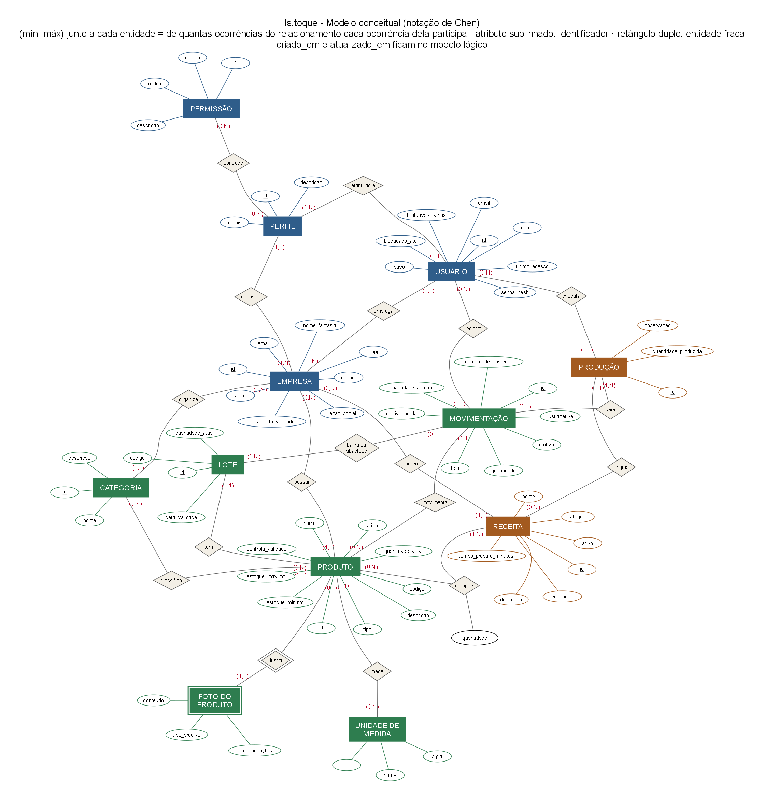
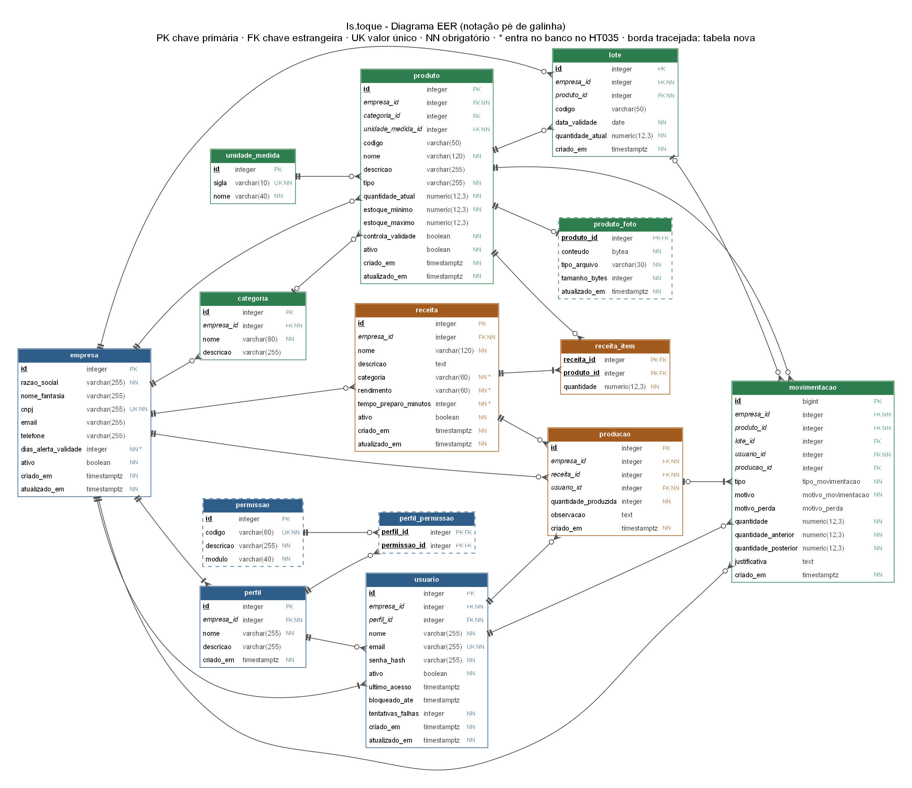

# Arquitetura da Solução

Esta página reúne os modelos do banco de dados do Is.toque. Eles cobrem o que já está no banco compartilhado e o que ainda vai entrar com os cards de estoque, receitas, produção, fotos e permissões, para que back e front trabalhem em cima das mesmas decisões.

O banco é PostgreSQL. O banco de desenvolvimento fica no Neon e é usado pela equipe toda. O de produção é outro, separado (HT007).

## Como os modelos foram feitos

Seguimos as três fases da análise de dados descritas por Oliveira (2002):

1. **Modelo conceitual**: entidades, relacionamentos e cardinalidades, sem pensar em tabelas.
2. **Modelo lógico**: o esquema relacional, com chaves, colunas opcionais, regras de integridade e tipos enumerados.
3. **Criação do banco**: as tabelas de fato, com os tipos do PostgreSQL. Aqui ela aparece no diagrama EER.

Convenções usadas no banco:

- nomes de tabelas e colunas em minúsculas, sem acento e no **singular** (`produto`, `receita_item`), iguais aos do código;
- chave primária `id`, gerada pelo banco (`integer` identity; `bigint` em `movimentacao`, que é a tabela que mais cresce);
- chave estrangeira com o nome da tabela + `_id` (`produto_id`);
- datas e horas em `timestamptz` (`criado_em`, `atualizado_em`), exibidas no fuso de Brasília pela API;
- quantidades em `numeric(12,3)`, para aceitar quilos e litros com 3 casas sem erro de arredondamento.

## Modelo conceitual

Notação de Chen: retângulo é entidade, losango é relacionamento e elipse é atributo. O atributo sublinhado é o identificador. A foto do produto é uma entidade fraca, porque só existe junto com o produto e é identificada por ele.

O par **(mín, máx)** fica ao lado de cada entidade e diz de quantas ocorrências do relacionamento cada ocorrência dela participa. Exemplo: no relacionamento *empresa cadastra perfil*, o `(1,1)` ao lado de PERFIL quer dizer que cada perfil pertence a uma e só uma empresa; o `(1,N)` ao lado de EMPRESA quer dizer que cada empresa tem pelo menos um perfil.

Para não poluir o diagrama, `criado_em` e `atualizado_em` aparecem só no modelo lógico.

### Relacionamentos e cardinalidades

| Relacionamento | Entidade A (mín, máx) | Entidade B (mín, máx) | Leitura |
|---|---|---|---|
| cadastra | EMPRESA (1,N) | PERFIL (1,1) | Cada empresa deve ter um ou mais perfis. Cada perfil pertence a uma única empresa. |
| concede | PERFIL (0,N) | PERMISSÃO (0,N) | Cada perfil pode ter várias permissões, e cada permissão pode estar em vários perfis. |
| emprega | EMPRESA (1,N) | USUÁRIO (1,1) | Cada empresa deve ter pelo menos um usuário (o administrador). Cada usuário pertence a uma única empresa. |
| atribuído a | PERFIL (0,N) | USUÁRIO (1,1) | Cada usuário deve ter um único perfil. Um perfil pode estar sem usuários. |
| organiza | EMPRESA (0,N) | CATEGORIA (1,1) | Cada categoria pertence a uma única empresa. |
| classifica | CATEGORIA (0,N) | PRODUTO (0,1) | O produto pode ter uma categoria ou nenhuma. |
| mede | UNIDADE DE MEDIDA (0,N) | PRODUTO (1,1) | Cada produto deve ter uma única unidade de medida. |
| possui | EMPRESA (0,N) | PRODUTO (1,1) | Cada produto pertence a uma única empresa. |
| ilustra | PRODUTO (0,1) | FOTO DO PRODUTO (1,1) | O produto pode ter no máximo uma foto. A foto pertence a um único produto. |
| tem | PRODUTO (0,N) | LOTE (1,1) | Cada lote é de um único produto. Só produto que controla validade tem lotes. |
| movimenta | PRODUTO (0,N) | MOVIMENTAÇÃO (1,1) | Cada movimentação é de um único produto. |
| baixa ou abastece | LOTE (0,N) | MOVIMENTAÇÃO (0,1) | A movimentação pode estar ligada a um lote, quando o produto controla validade. |
| registra | USUÁRIO (0,N) | MOVIMENTAÇÃO (1,1) | Cada movimentação é registrada por um único usuário. |
| mantém | EMPRESA (0,N) | RECEITA (1,1) | Cada receita pertence a uma única empresa. |
| compõe | RECEITA (1,N) | PRODUTO (0,N) | Cada receita deve ter um ou mais produtos, com a **quantidade** de cada um por unidade produzida. Um produto pode estar em várias receitas. |
| origina | RECEITA (0,N) | PRODUÇÃO (1,1) | Cada produção é de uma única receita. |
| executa | USUÁRIO (0,N) | PRODUÇÃO (1,1) | Cada produção é registrada por um único usuário. |
| gera | PRODUÇÃO (1,N) | MOVIMENTAÇÃO (0,1) | Cada produção gera uma ou mais saídas de estoque. Movimentações de compra, venda, ajuste etc. não vêm de produção. |

Os relacionamentos *concede* e *compõe* são m:n. No modelo lógico eles viram as entidades associativas `perfil_permissao` e `receita_item`; a segunda é atributiva, porque guarda a quantidade (Oliveira, 2002).

## Modelo lógico

### Esquema relacional

Chave primária sublinhada, chave estrangeira com `#` e a tabela de destino entre colchetes. Colunas opcionais (que aceitam nulo) estão marcadas com `?`.

- **empresa** (<u>id</u>, razao_social, nome_fantasia?, cnpj, email?, telefone?, dias_alerta_validade, ativo, criado_em, atualizado_em)
- **perfil** (<u>id</u>, #empresa_id [empresa], nome, descricao?, criado_em)
- **permissao** (<u>id</u>, codigo, descricao, modulo)
- **perfil_permissao** (<u>#perfil_id</u> [perfil], <u>#permissao_id</u> [permissao])
- **usuario** (<u>id</u>, #empresa_id [empresa], #perfil_id [perfil], nome, email, senha_hash, ativo, ultimo_acesso?, bloqueado_ate?, tentativas_falhas, criado_em, atualizado_em)
- **unidade_medida** (<u>id</u>, sigla, nome)
- **categoria** (<u>id</u>, #empresa_id [empresa], nome, descricao?)
- **produto** (<u>id</u>, #empresa_id [empresa], #categoria_id? [categoria], #unidade_medida_id [unidade_medida], codigo?, nome, descricao?, tipo, quantidade_atual, estoque_minimo, estoque_maximo?, controla_validade, ativo, criado_em, atualizado_em)
- **produto_foto** (<u>#produto_id</u> [produto], conteudo, tipo_arquivo, tamanho_bytes, atualizado_em)
- **lote** (<u>id</u>, #empresa_id [empresa], #produto_id [produto], codigo?, data_validade, quantidade_atual, criado_em)
- **movimentacao** (<u>id</u>, #empresa_id [empresa], #produto_id [produto], #lote_id? [lote], #usuario_id [usuario], #producao_id? [producao], tipo, motivo, motivo_perda?, quantidade, quantidade_anterior, quantidade_posterior, justificativa?, criado_em)
- **receita** (<u>id</u>, #empresa_id [empresa], nome, descricao?, categoria, rendimento, tempo_preparo_minutos, ativo, criado_em, atualizado_em)
- **receita_item** (<u>#receita_id</u> [receita], <u>#produto_id</u> [produto], quantidade)
- **producao** (<u>id</u>, #empresa_id [empresa], #receita_id [receita], #usuario_id [usuario], quantidade_produzida, observacao?, criado_em)

`lote`, `movimentacao` e `producao` também guardam `empresa_id`, embora a empresa já possa ser achada pelo produto ou pela receita. A redundância é proposital: as consultas por empresa e período (histórico, relatórios) usam esse campo direto nos índices, e o isolamento entre empresas (HT002) fica mais simples de garantir. A API grava sempre a mesma empresa do produto.

### Regras de integridade

**Chaves e unicidade**

- Toda chave estrangeira aponta para uma linha que existe (integridade referencial). Apagar um perfil apaga as suas linhas em `perfil_permissao`; apagar uma receita apaga os seus itens; apagar um produto apaga a sua foto. Nos demais casos o banco recusa a exclusão, e a aplicação usa desativação (`ativo = false`) para não perder histórico.
- `empresa.cnpj` é único.
- `usuario.email` é único no sistema todo, não só na empresa (HT013).
- `perfil (empresa_id, nome)`, `categoria (empresa_id, nome)`, `produto (empresa_id, nome)` e `produto (empresa_id, codigo)` são únicos.
- `receita (empresa_id, nome)` é único **só entre as receitas ativas** (índice único parcial com `WHERE ativo`). Assim uma receita desativada não impede cadastrar outra com o mesmo nome.
- `permissao.codigo` e `unidade_medida.sigla` são únicos.
- `receita_item` tem chave `(receita_id, produto_id)`: o mesmo produto não se repete na receita.
- `produto_foto` tem chave `produto_id`: no máximo uma foto por produto.

**Valores**

- `produto.tipo` aceita `insumo`, `revenda` ou `ambos`.
- `produto.quantidade_atual >= 0`, `produto.estoque_minimo >= 0` e `estoque_maximo` nulo ou `>= estoque_minimo`.
- `lote.quantidade_atual >= 0`: o saldo de um lote nunca fica negativo.
- `movimentacao.quantidade > 0`, `receita_item.quantidade > 0` e `producao.quantidade_produzida > 0`.
- `receita.tempo_preparo_minutos > 0`.
- `empresa.dias_alerta_validade` é obrigatório, com padrão 3.
- `produto_foto.tipo_arquivo` aceita `image/jpeg`, `image/png` ou `image/webp`, e `tamanho_bytes` vai de 1 a 5.242.880 (5 MB).
- As regras de `movimentacao` que dependem do motivo estão na tabela da próxima seção.

**Regras que ficam na aplicação**

Algumas regras dependem de outras tabelas ou do usuário logado, e por isso ficam no back-end: a saída não pode passar do saldo do produto (RE-04), a produção não pode passar da capacidade calculada (RE-08), o ajuste exige justificativa com pelo menos 10 caracteres, os produtos de uma receita têm de ser da mesma empresa e estar ativos, e a quantidade respeita a unidade (`un` só aceita número inteiro).

### Tipos enumerados

O banco tem três tipos `enum` do PostgreSQL, todos usados em `movimentacao`:

- `tipo_movimentacao`: `entrada`, `saida`
- `motivo_movimentacao`: `compra`, `reposicao`, `venda`, `consumo`, `producao`, `perda`, `descarte`, `ajuste`, `outro`
- `motivo_perda`: `vencimento`, `deterioracao`, `armazenamento_inadequado`, `acidente`, `outro`

O tipo do produto não é `enum` nativo: é texto com uma restrição `CHECK`, porque o Hibernate apagava a coluna a cada reinício quando ela usava um tipo nativo (HT026).

Regra de cada motivo:

| Motivo | Tipo | Exige `motivo_perda` | Exige justificativa | Observação |
|---|---|---|---|---|
| `compra` | entrada | não | não | |
| `reposicao` | entrada | não | não | |
| `venda` | saída | não | não | |
| `consumo` | saída | não | não | |
| `producao` | saída | não | não | Exige `producao_id`; só a produção (HU017) grava este motivo. |
| `perda` | saída | sim | só se `motivo_perda = outro` | |
| `descarte` | saída | sim | só se `motivo_perda = outro` | |
| `ajuste` | entrada ou saída | não | sim | Só com a permissão `estoque.ajustar` (HU011). |
| `outro` | entrada ou saída | não | sim | |

No banco, essas regras viram restrições `CHECK` em `movimentacao`: motivo de entrada só com `tipo = entrada`, motivo de saída só com `tipo = saida`, `motivo_perda` preenchido se e somente se o motivo for perda ou descarte, `producao_id` preenchido se e somente se o motivo for produção, e justificativa não vazia nos motivos `ajuste` e `outro` e no `motivo_perda = outro`.

### Índices

Além dos índices das chaves primárias e das restrições de unicidade:

- `movimentacao (produto_id, criado_em)` e `movimentacao (empresa_id, criado_em)`: histórico por produto e por período;
- `movimentacao (producao_id)`: saídas de uma produção;
- `lote (produto_id, data_validade)`: baixa do lote que vence primeiro e alertas de validade;
- `producao (empresa_id, criado_em)`: lista de produções e relatório;
- `produto (categoria_id)` e `usuario (empresa_id)`.

## Diagrama EER

Notação pé de galinha. Nas pontas das linhas, o traço indica "um", o círculo indica "zero" (opcional) e o tridente indica "muitos" (Oliveira, 2002). Cada coluna aparece com o seu tipo no PostgreSQL. As tabelas com borda tracejada ainda não existem no banco, e as colunas com `*` mudam ou entram no HT035.

## Decisões

**Receita.** As telas de ficha técnica pedem categoria, rendimento e tempo de preparo, que o modelo anterior não tinha. Ficaram assim:

- `categoria varchar(60)`, obrigatória. É um texto livre (as telas oferecem Lanches, Refeições e Entradas) e não usa a tabela `categoria`, que é de produtos.
- `rendimento varchar(60)`, obrigatório. É o texto que a tela mostra, como "1 porção" ou "10 unidades". O cálculo de produção não usa esse campo: as quantidades de `receita_item` são sempre para uma unidade produzida (PE-09).
- `tempo_preparo_minutos integer`, obrigatório e maior que zero.

**Foto do produto (RF-34, RE-11).** A foto fica numa tabela própria, `produto_foto`, e não numa coluna de `produto`. Assim a listagem de produtos não carrega a imagem junto, e a foto pode ser trocada ou removida sem mexer no produto. A imagem é gravada no próprio banco (`bytea`), com o tipo do arquivo e o tamanho; não há serviço de arquivos separado para manter. O limite é de 5 MB, nos formatos JPEG, PNG e WebP, como na tela de edição de produto.

**Alerta de validade.** Cada empresa define em quantos dias antes do vencimento um lote entra no alerta (`empresa.dias_alerta_validade`). O padrão é 3 dias, e quem tem `empresa.configurar` pode mudar (HU013).

**Permissões.** As permissões ficam num catálogo próprio (`permissao`), igual para todas as empresas. Cada empresa monta os seus perfis escolhendo códigos desse catálogo (`perfil_permissao`). São nove códigos (HU007):

| Código | Módulo | Descrição |
|---|---|---|
| `usuarios.gerenciar` | usuarios | Cadastrar, editar, desativar e reativar usuários |
| `perfis.gerenciar` | perfis | Criar e editar perfis e as suas permissões |
| `empresa.configurar` | empresa | Alterar os dados e as configurações da empresa |
| `produtos.gerenciar` | produtos | Cadastrar e editar produtos, categorias e fotos |
| `estoque.movimentar` | estoque | Registrar entradas, saídas, perdas e descartes |
| `estoque.ajustar` | estoque | Ajustar o saldo com justificativa |
| `receitas.gerenciar` | receitas | Cadastrar e editar fichas técnicas |
| `producao.registrar` | producao | Registrar produções |
| `relatorios.ver` | relatorios | Ver os relatórios |

Toda empresa nova recebe os três perfis padrão com esta matriz:

| Código | Administrador | Gerente | Funcionário |
|---|:-:|:-:|:-:|
| `usuarios.gerenciar` | ✓ | | |
| `perfis.gerenciar` | ✓ | | |
| `empresa.configurar` | ✓ | | |
| `produtos.gerenciar` | ✓ | ✓ | |
| `estoque.movimentar` | ✓ | ✓ | ✓ |
| `estoque.ajustar` | ✓ | ✓ | |
| `receitas.gerenciar` | ✓ | ✓ | |
| `producao.registrar` | ✓ | ✓ | ✓ |
| `relatorios.ver` | ✓ | ✓ | |

O Administrador nunca perde `usuarios.gerenciar` nem `perfis.gerenciar`, para que a empresa não fique sem quem a administre.

## Evolução do banco

Conferimos os modelos com as entidades do código (branch `main`) e com o banco de desenvolvimento em 09/10/2026. O banco foi criado a partir do modelo anterior (`ux/references/modelagem/modelagem-01-istoque.pdf`), que usava nomes no plural; as tabelas já foram renomeadas para o singular. Hoje o banco tem 12 tabelas: as seis que o código usa (`empresa`, `perfil`, `usuario`, `categoria`, `unidade_medida` e `produto`) e outras seis que existem mas ainda não são usadas e estão vazias (`lote`, `movimentacao`, `receita`, `receita_item`, `producao` e `perfil_permissao`), além dos três tipos enumerados e da tabela de controle do Flyway (`flyway_schema_history`).

O que cada card muda:

**HT030: migrações com Flyway** (feito)

- A migração `V1__estado_inicial.sql` reproduz o banco como ele estava, inclusive as tabelas ainda sem uso. Rodada num PostgreSQL vazio, ela gera o mesmo esquema do banco de desenvolvimento.
- O banco de desenvolvimento foi marcado como estando na V1 (baseline) em 09/10/2026, sem alterar nenhuma tabela.
- O `ddl-auto` passou de `update` para `validate`, e a entidade `Perfil` ganhou `criado_em`.
- O banco de produção tinha só `empresa`, `perfil` e `usuario`, criadas pelo Hibernate. Em 09/10/2026 o esquema dele foi igualado ao da V1, mantendo os registros, e agora é o mesmo do banco de desenvolvimento. Ele também foi marcado como estando na V1 (baseline).
- Como criar uma migração nova está no [README do backend](../codigo-fonte/Backend/istoque/README.md).

**HT035: tabelas de estoque, receitas, produção e fotos**

- `receita`: entram `categoria`, `rendimento` e `tempo_preparo_minutos`. O índice único `(empresa_id, nome)` passa a valer só para as receitas ativas.
- Nova tabela `produto_foto`.
- `empresa.dias_alerta_validade`: hoje aceita nulo e tem padrão 7. Passa a ser obrigatório, com padrão 3.
- `movimentacao`: hoje só o motivo `ajuste` exige justificativa. Passam a exigir também o motivo `outro` e o `motivo_perda = outro`.
- `unidade_medida`: sai a sigla `UN`, repetida de `un`. Nenhum produto usa `UN` hoje.
- `perfil`: sai o índice único repetido. Hoje existem dois iguais em `(empresa_id, nome)`: `uk_perfil_empresa_nome` e `perfis_empresa_id_nome_idx`.
- `lote`, `movimentacao`, `receita_item` e `producao` já estão no banco como neste modelo. O HT035 só confere e corrige o que estiver diferente.

**HU007: permissões de cada perfil**

- Nova tabela `permissao`, com os nove códigos.
- `perfil_permissao` é refeita. Hoje ela guarda o código como texto, com oito códigos antigos (`USUARIO_GERENCIAR`, `PERDA_REGISTRAR` e outros). Passa a apontar para `permissao` por `permissao_id`.
- Os perfis das empresas que já existem recebem a matriz padrão.

**Requisitos relacionados:** RF-05, RF-06, RF-11 a RF-34, RE-04 a RE-11.
