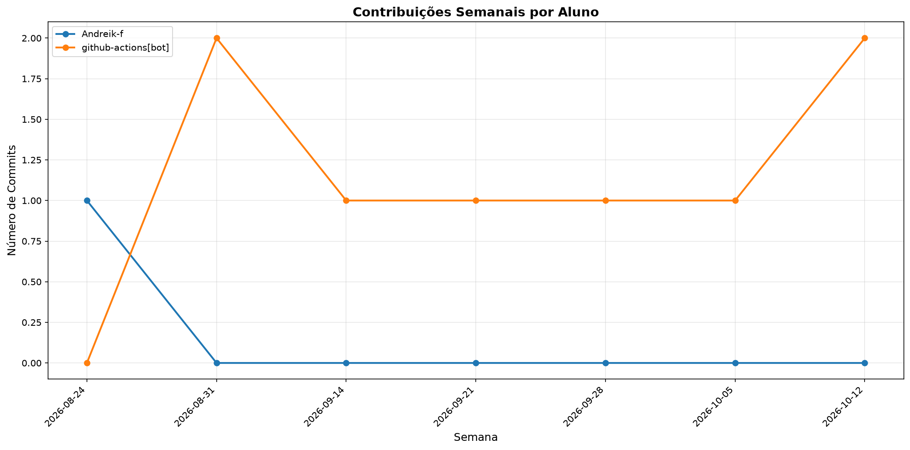

# 📊 Relatório de Contribuições do Projeto

**Última atualização:** 26/10/2026 03:58

---

## 📈 Resumo Geral de Contribuições

| Aluno               |   Commits |   Linhas+ |   Linhas- |   Arquivos |   Docs Commits |   Docs Arquivos |
|---------------------|-----------|-----------|-----------|------------|----------------|-----------------|
| Andreik-f           |         1 |       794 |         0 |         23 |              1 |               1 |
| github-actions[bot] |         8 |        79 |        23 |          3 |              8 |               1 |

## 📅 Contribuições Semanais (Todo o Semestre)

**2026-10-12**: github-actions[bot]: 2

**2026-10-05**: github-actions[bot]: 1

**2026-09-28**: github-actions[bot]: 1

**2026-09-21**: github-actions[bot]: 1

**2026-09-14**: github-actions[bot]: 1

**2026-08-31**: github-actions[bot]: 2

**2026-08-24**: Andreik-f: 1

## 📊 Visualização Gráfica

## ℹ️ Observações

- **Commits**: Número total de commits realizados

- **Linhas+**: Linhas de código adicionadas

- **Linhas-**: Linhas de código removidas

- **Arquivos**: Número de arquivos únicos modificados

- **Docs Commits**: Commits em arquivos de documentação

- **Docs Arquivos**: Arquivos de documentação modificados

---

*Relatório gerado automaticamente via GitHub Actions*
