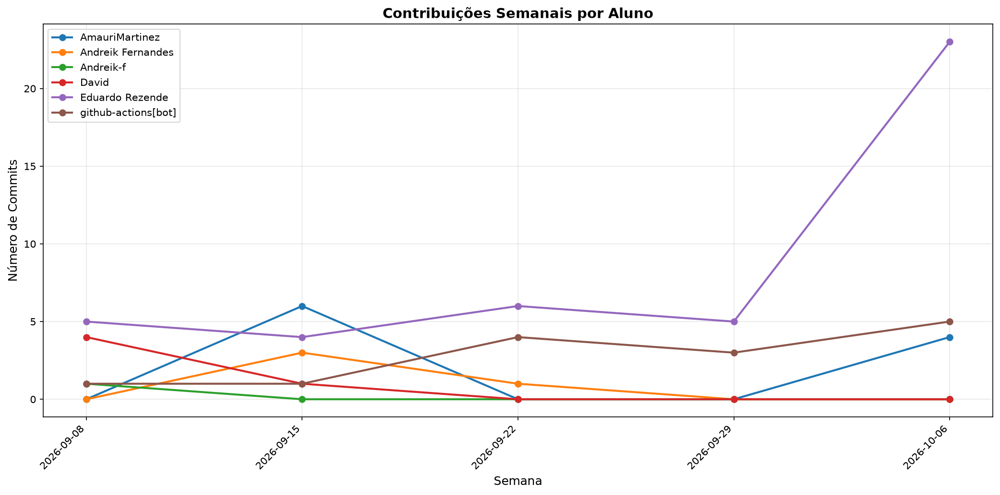

# 📊 Relatório de Contribuições do Projeto

**Última atualização:** 30/09/2026 18:39

---

## 📈 Resumo Geral de Contribuições

| Aluno               |   Commits |   Linhas+ |   Linhas- |   Arquivos |   Docs Commits |   Docs Arquivos |
|---------------------|-----------|-----------|-----------|------------|----------------|-----------------|
| AmauriMartinez      |         8 |       584 |        87 |         18 |              0 |               0 |
| Andreik Fernandes   |         4 |       958 |         4 |          7 |              0 |               0 |
| Andreik-f           |         1 |        30 |         0 |          2 |              0 |               0 |
| David               |         5 |       810 |         2 |         24 |              2 |               1 |
| Eduardo Rezende     |        51 |     88494 |     83661 |        353 |              1 |               1 |
| github-actions[bot] |         6 |        77 |        25 |          3 |              6 |               1 |

## 📅 Contribuições Semanais (Todo o Semestre)

**2026-09-23**: Andreik Fernandes: 1, Eduardo Rezende: 37, github-actions[bot]: 4

**2026-09-16**: AmauriMartinez: 6, Andreik Fernandes: 3, David: 1, Eduardo Rezende: 9, github-actions[bot]: 1

**2026-09-09**: AmauriMartinez: 2, Andreik-f: 1, David: 4, Eduardo Rezende: 5, github-actions[bot]: 1

## 📊 Visualização Gráfica

## ℹ️ Observações

- **Commits**: Número total de commits realizados

- **Linhas+**: Linhas de código adicionadas

- **Linhas-**: Linhas de código removidas

- **Arquivos**: Número de arquivos únicos modificados

- **Docs Commits**: Commits em arquivos de documentação

- **Docs Arquivos**: Arquivos de documentação modificados

---

*Relatório gerado automaticamente via GitHub Actions*
