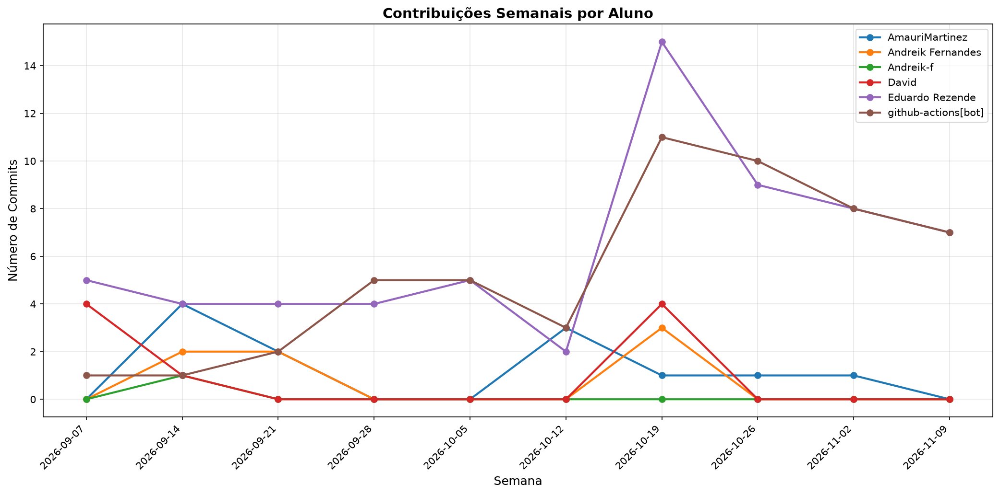

# 📊 Relatório de Contribuições do Projeto

**Última atualização:** 23/11/2026 06:36

---

## 📈 Resumo Geral de Contribuições

| Aluno               |   Commits |   Linhas+ |   Linhas- |   Arquivos |   Docs Commits |   Docs Arquivos |
|---------------------|-----------|-----------|-----------|------------|----------------|-----------------|
| AmauriMartinez      |        12 |      1989 |       112 |         45 |              0 |               0 |
| Andreik Fernandes   |         7 |      2292 |        45 |         34 |              0 |               0 |
| Andreik-f           |         1 |        30 |         0 |          2 |              0 |               0 |
| David               |         9 |      1136 |       215 |         24 |              4 |               1 |
| Eduardo Rezende     |        63 |    149671 |     45129 |        689 |              4 |               1 |
| github-actions[bot] |        53 |       478 |       412 |          3 |             53 |               1 |

## 📅 Contribuições Semanais (Todo o Semestre)

**2026-11-09**: Eduardo Rezende: 7, github-actions[bot]: 7

**2026-11-02**: AmauriMartinez: 1, Eduardo Rezende: 8, github-actions[bot]: 8

**2026-10-26**: AmauriMartinez: 1, Eduardo Rezende: 9, github-actions[bot]: 10

**2026-10-19**: AmauriMartinez: 1, Andreik Fernandes: 3, David: 4, Eduardo Rezende: 15, github-actions[bot]: 11

**2026-10-12**: AmauriMartinez: 3, Eduardo Rezende: 2, github-actions[bot]: 3

**2026-10-05**: Eduardo Rezende: 5, github-actions[bot]: 5

**2026-09-28**: Eduardo Rezende: 4, github-actions[bot]: 5

**2026-09-21**: AmauriMartinez: 2, Andreik Fernandes: 2, Eduardo Rezende: 4, github-actions[bot]: 2

**2026-09-14**: AmauriMartinez: 4, Andreik Fernandes: 2, Andreik-f: 1, David: 1, Eduardo Rezende: 4, github-actions[bot]: 1

**2026-09-07**: David: 4, Eduardo Rezende: 5, github-actions[bot]: 1

## 📊 Visualização Gráfica

## ℹ️ Observações

- **Commits**: Número total de commits realizados

- **Linhas+**: Linhas de código adicionadas

- **Linhas-**: Linhas de código removidas

- **Arquivos**: Número de arquivos únicos modificados

- **Docs Commits**: Commits em arquivos de documentação

- **Docs Arquivos**: Arquivos de documentação modificados

---

*Relatório gerado automaticamente via GitHub Actions*
